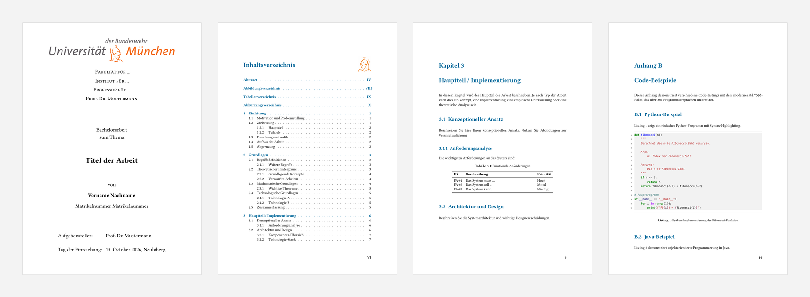

# LaTeX-Vorlage für wissenschaftliche Arbeiten - UniBw München


[](https://creativecommons.org/licenses/by/4.0/)


Moderne LaTeX-Vorlage für Seminar-, Bachelor-, Master- und Doktorarbeiten an der Universität der Bundeswehr München – für alle Fakultäten, optimiert für **LuaLaTeX** (Stand: 2026).

> **🚀 Neu hier?** → Direkt zum [Schnellstart](#-schnellstart).
>
> **Lieber Typst statt LaTeX?** Es gibt dieselbe Vorlage auch als Typst-Version mit gleichem Aufbau und gleichen Metadaten:
> [typst-thesis-unibw](https://github.com/nkoeberlein/typst-thesis-unibw)

> **📘 Formale Vorgaben:** Maßgeblich sind die Prüfungsordnung, die Richtlinien der Fakultät und die Vorgaben der betreuenden Professur.



<sub>Titelseite · Inhaltsverzeichnis · Kapitel mit Tabelle · Code-Anhang – erzeugt aus dieser Vorlage ohne Änderungen.</sub>

## ✨ Features

- **Modernes LaTeX**: Vollständig auf LuaLaTeX optimiert (keine veralteten Pakete)
- **Code-Highlighting**: Minted-Integration für 300+ Programmiersprachen
- **Unicode-Support**: Native Unterstützung für UTF-8, Emojis und Sonderzeichen
- **Professionelles Layout**: UniBw München Corporate Design
- **Automatisierte Verzeichnisse**: Inhalt, Abbildungen, Tabellen, Abkürzungen, Glossar
- **Moderne Tabellen**: tabularray statt veralteter Pakete
- **Flexible Bibliographie**: BibLaTeX mit Biber-Backend

## 📋 Voraussetzungen

> **📖 Ausführliche Installationsanleitung:** Siehe [docus/LaTeX-Installation.md](docus/LaTeX-Installation.md) für eine Schritt-für-Schritt-Anleitung zur Installation von TeX Live, VS Code und Antigravity.

### Erforderliche Software

1. **LuaLaTeX** (TeX Live 2023 oder neuer empfohlen)
  - Windows: [MiKTeX](https://miktex.org/) oder [TeX Live](https://www.tug.org/texlive/)
  - macOS: [MacTeX](https://www.tug.org/mactex/)
  - Linux: `sudo apt-get install texlive-full` (Ubuntu/Debian)

2. **Python 3** (für minted Code-Highlighting)
   ```bash
   sudo apt-get install python3 python3-pip
   ```

3. **Pygments** (Syntax-Highlighting-Bibliothek)
   ```bash
   pip3 install Pygments
   ```

4. **Biber** (Bibliographie-Tool, meist in TeX-Distribution enthalten)

### Optional

- **Visual Studio Code** mit [LaTeX Workshop Extension](https://marketplace.visualstudio.com/items?itemName=James-Yu.latex-workshop)
- **TeXstudio** oder **Overleaf** (mit LuaLaTeX-Einstellung)

## 🚀 Schnellstart

### 1. Vorlage anpassen

1. **Persönliche Angaben**: Öffnen Sie `metadata.tex` – das ist die einzige Datei, die Sie zu Beginn anpassen müssen.
   Titelseite, Eigenständigkeitserklärung, Exposé und PDF-Metadaten lesen ihre Angaben von dort.
   - Name, Matrikelnummer, Titel, Art der Arbeit
   - Fakultät, Institut, Professur
   - Gutachter/Betreuer – `\reviewertwo` und `\advisor` leer lassen (`{}`), um sie auf der Titelseite auszublenden
   - Abgabedatum (`\timeend`) und Ort (`\myplace`)

2. **Hauptdokument**: Öffnen Sie `1Main.tex`
   - Schalter oben: `\isprinttrue` für die Druckfassung (doppelseitig, Kapitel rechts, Bindekorrektur),
     `\isdrafttrue` für ein ENTWURF-Wasserzeichen
   - Aktivieren/deaktivieren Sie gewünschte Verzeichnisse
   - Fügen Sie Ihre Kapitel hinzu

3. **Kapitel schreiben**:
   - Bearbeiten Sie die Dateien in `content/`
   - Nutzen Sie die Beispiele als Vorlage

### 2. Kompilierung

#### Mit latexmk (empfohlen)

```bash
latexmk 1Main.tex        # LuaLaTeX + Biber + makeglossaries, so oft wie nötig
latexmk -pvc 1Main.tex   # Automatisch neu bauen bei jeder Änderung
latexmk Skript.tex       # Exposé / Ideenskizze
latexmk -c               # Hilfsdateien entfernen
```

Die Konfiguration steht in `.latexmkrc`.

#### Manuell (ohne latexmk)

```bash
# Vollständige Kompilierung mit allen Verzeichnissen
lualatex --shell-escape 1Main.tex
makeglossaries 1Main
biber 1Main
lualatex --shell-escape 1Main.tex
lualatex --shell-escape 1Main.tex
```

#### Mit Shell-Script

```bash
./compile.sh            # Vollständig (nutzt latexmk, falls vorhanden)
./compile.sh Skript     # Exposé bauen
./compile.sh --fast     # Schnelle Vorschau (nur 1× LuaLaTeX)
./compile.sh --clean    # Erst bereinigen, dann kompilieren
```

#### Nur bereinigen

```bash
./clean-latex.sh
```

## 📁 Projektstruktur

```
wissenschaftlArbeit/
├── 1Main.tex                    # Hauptdokument (Schalter \ifisprint / \ifisdraft)
├── metadata.tex                 # Persönliche Angaben – hier beginnen
├── Skript.tex                   # Exposé / Ideenskizze
├── .latexmkrc                   # latexmk-Konfiguration
├── README.md                    # Diese Datei
├── compile.sh                   # Kompilierungsskript
├── clean-latex.sh              # Aufräumskript
│
├── content/                    # Ihre Kapitel
│   ├── Einleitung.tex
│   ├── Grundlagen.tex
│   ├── Hauptteil.tex
│   ├── Schluss.tex
│   ├── Code.tex               # Anhang: Code-Beispiele
│   └── allgemein/
│       ├── Abstract.tex
│       └── Glossar.tex        # Glossar-Definitionen
│
├── default_frame/             # Verzeichnisse und formale Seiten
│   ├── Titelseite.tex
│   ├── Inhaltsverzeichnis.tex
│   ├── Literaturverzeichnis.tex
│   ├── Glossar.tex
│   └── Eigenstaendigkeitserklaerung.tex
│
├── default_style/             # Styling und Pakete
│   ├── load_all.tex          # Lädt alle Konfigurationen + metadata.tex
│   ├── setup.tex             # Dokumentklasse, Pakete, Schriftarten
│   ├── layout.tex            # Ränder, Kopf-/Fußzeilen, Überschriften, Glossar-Stil
│   ├── style.tex             # Farben, Fußnoten, Code (minted), Hyperref
│   ├── watermark.tex         # ENTWURF-Wasserzeichen
│   └── Signet_UniBw.pdf, Athene*.png
│
├── bibliography/
│   └── references.bib        # Ihre Literaturquellen
│
├── media/                    # Bilder und Grafiken
└── fonts/                    # Optional: eigene Bookerly-Kopie (siehe fonts/README.md)
```

## 📝 Verwendung

### Kapitel hinzufügen

1. Erstellen Sie eine neue `.tex`-Datei in `content/`
2. Fügen Sie in `1Main.tex` hinzu:
   ```latex
   \input{content/NeuesKapitel}
   \newpage
   ```

### Literatur zitieren

1. Fügen Sie Einträge in `bibliography/references.bib` hinzu:
   ```bibtex
   @article{autor2024titel,
       author = {Autor, Max},
       title = {Titel des Artikels},
       journal = {Zeitschrift},
       year = {2024}
   }
   ```

2. Zitieren Sie im Text:
   ```latex
   Wie in \cite{autor2024titel} beschrieben, \dots
   ```

### Glossar/Abkürzungen verwenden

1. Definieren Sie Begriffe in `content/allgemein/Glossar.tex`:
   ```latex
   \newacronym{api}{API}{Application Programming Interface}
   ```

2. Verwenden Sie im Text:
   ```latex
   \gls{api}  % Beim ersten Mal: Application Programming Interface (API)
              % Später: API
   ```

### Code-Listings

Mit minted (empfohlen):
```latex
\begin{listing}[htbp]
\begin{minted}[linenos,frame=lines]{python}
def hello_world():
    print("Hello, World!")
\end{minted}
\caption{Python Hello World}
\label{lst:hello}
\end{listing}
```

### Tabellen

Mit booktabs (modern):
```latex
\begin{table}[htbp]
    \centering
    \caption{Beispieltabelle}
    \label{tab:beispiel}
    \begin{tabular}{lcc}
        \toprule
        \textbf{Spalte 1} & \textbf{Spalte 2} & \textbf{Spalte 3} \\
        \midrule
        Wert 1 & Wert 2 & Wert 3 \\
        \bottomrule
    \end{tabular}
\end{table}
```

## 🎨 Anpassungen

### Farben ändern

Bearbeiten Sie `default_style/style.tex` (Abschnitt „Farben“):
```latex
\definecolor{primary}{RGB}{0, 102, 153}
\definecolor{secondary}{RGB}{102, 102, 102}
```

### Schriftart ändern

Bearbeiten Sie `default_style/setup.tex` (Abschnitt „Schriftarten“):
```latex
\setmainfont{TeX Gyre Termes}  % Times-ähnlich
% Alternative:
% \setmainfont{Latin Modern Roman}
```

## 🔧 Problembehandlung

### "minted Error: You must invoke LaTeX with the -shell-escape flag"

**Lösung**: Verwenden Sie `--shell-escape` beim Kompilieren:
```bash
lualatex --shell-escape 1Main.tex
```

In TeXstudio: Optionen → TeXstudio konfigurieren → Befehle → LuaLaTeX:
```
lualatex -synctex=1 -interaction=nonstopmode --shell-escape %.tex
```

### "Package minted Error: Missing Pygments"

**Lösung**: Installieren Sie Pygments:
```bash
pip3 install Pygments
```

### "I can't find file 'XYZ.tex'"

**Lösung**: Prüfen Sie die Pfade in `1Main.tex` - alle Pfade müssen relativ zum Hauptdokument sein.

### Glossar wird nicht angezeigt

**Lösung**: Führen Sie `makeglossaries` aus:
```bash
makeglossaries 1Main
```

### Bibliographie ist leer

**Lösung**:
1. Prüfen Sie, ob Sie `\cite{...}` im Text verwendet haben
2. Führen Sie `biber 1Main` aus
3. Kompilieren Sie erneut mit LuaLaTeX

## 📚 Dokumentation

- Typst-Version dieser Vorlage: [typst-thesis-unibw](https://github.com/nkoeberlein/typst-thesis-unibw)
- LaTeX-Einführung: [Overleaf Documentation](https://www.overleaf.com/learn)
- BibLaTeX: [BibLaTeX Documentation](https://ctan.org/pkg/biblatex)
- Minted: [Minted Manual](https://ctan.org/pkg/minted)

## 🤝 Beitragen

Diese Vorlage wurde für Studierende der UniBw München erstellt. Verbesserungsvorschläge sind willkommen!

## ❓ FAQ - Häufig gestellte Fragen

### Allgemeine Fragen

**Q: Kann ich diese Vorlage für meine Arbeit verwenden?**  
A: Ja! Die Vorlage ist für alle wissenschaftlichen Arbeiten an der UniBw München gedacht.

**Q: Muss ich LuaLaTeX verwenden oder geht auch pdfLaTeX?**  
A: Diese Vorlage ist speziell für LuaLaTeX optimiert. Mit pdfLaTeX würde sie nicht funktionieren (moderne Pakete, Unicode-Support).

**Q: Wo finde ich eine Schnellstart-Anleitung?**  
A: Siehe den Abschnitt [Schnellstart](#-schnellstart) oben.

### Kompilierung

**Q: Wie oft muss ich kompilieren?**  
A: Für korrekte Referenzen mindestens 3-4 Mal. `latexmk` (bzw. `./compile.sh`) erledigt das automatisch.

**Q: Die Kompilierung dauert sehr lange, gibt es eine schnellere Alternative?**  
A: Ja! Verwenden Sie `./compile.sh --fast` für schnelle Vorschauen (nur 1× LuaLaTeX).

**Q: Gibt es einen Watch-Modus?**  
A: Ja: `latexmk -pvc 1Main.tex` kompiliert automatisch neu, wenn Sie .tex oder .bib Dateien ändern.

### Inhalte

**Q: Das Inhaltsverzeichnis ist leer!**  
A: Kompilieren Sie mehrmals (mindestens 2×). Das ist normal bei LaTeX - erst beim zweiten Durchlauf werden die Referenzen aufgelöst.

**Q: Meine Glossar-Einträge erscheinen nicht!**  
A: Glossar-Einträge müssen im Text verwendet werden (`\gls{begriff}`), damit sie im Glossar erscheinen.

**Q: Das Literaturverzeichnis bleibt leer!**  
A: Sie müssen Quellen im Text zitieren (`\cite{key}`). Nur definierte Quellen, die auch zitiert wurden, erscheinen.

**Q: Kann ich die Beispiel-Kapitel löschen?**  
A: Besser nicht! Nutzen Sie sie als Vorlage und ersetzen Sie den Inhalt. Die Struktur ist bewährt.

### Anpassungen

**Q: Wie ändere ich die Schriftart?**  
A: Bearbeiten Sie `default_style/setup.tex`. Dort können Sie andere Fonts mit `\setmainfont{...}` setzen.

**Q: Kann ich die UniBw-Farben ändern?**  
A: Technisch ja, aber für offizielle Arbeiten sollten die Corporate Design Farben beibehalten werden.

**Q: Wie füge ich ein neues Kapitel hinzu?**  
A: Erstellen Sie eine .tex-Datei in `content/` und fügen Sie in `1Main.tex` ein: `\input{content/NeuesKapitel}`

### Fehler und Probleme

**Q: "Missing Pygments" Fehler**  
A: Installieren Sie Pygments: `pip3 install Pygments`

**Q: "shell-escape" Fehler**  
A: Verwenden Sie das Flag `--shell-escape` beim Kompilieren. Die Scripts machen das automatisch.

**Q: "Font not found" Warnung**  
A: Die Vorlage nutzt *Libertinus Serif*, die in TeX Live (`texlive-full` bzw. Paket `libertinus-fonts`) enthalten ist. Fehlt sie, installieren Sie das Paket nach. Eine eigene Bookerly-Kopie in `fonts/` wird automatisch bevorzugt.

**Q: Kompilierung bricht ab**  
A: 
1. Prüfen Sie die `.log` Datei für Details
2. Häufigste Ursachen: Syntaxfehler (z.B. fehlende `}` Klammer), fehlende Pakete, ungültige Zeichen
3. Zeile-für-Zeile Kommentieren (`%`) hilft beim Eingrenzen

### Best Practices

**Q: Soll ich Bilder als PNG oder PDF einbinden?**  
A: PDF für Vektorgrafiken (scharf bei jeder Größe), PNG für Screenshots/Fotos.

**Q: Wie organisiere ich große Arbeiten am besten?**  
A: Ein Kapitel = Eine Datei. Nutzen Sie aussagekräftige Dateinamen und Labels (`\label{chap:einleitung}`).

**Q: Sollte ich die Build-Dateien (.aux, .log) in Git committen?**  
A: Nein! Die `.gitignore` enthält bereits alle temporären Dateien. Nur die .tex, .bib und Medien-Dateien committen.

**Q: Wie kann ich die Vorlage weitergeben?**  
A: Löschen Sie erst Ihre Inhalte und Build-Artefakte (`./clean-latex.sh`), dann können Sie den gesamten Ordner teilen.

---

## 📄 Lizenz

Diese Vorlage steht unter der [Creative Commons Attribution 4.0 International (CC BY 4.0)](https://creativecommons.org/licenses/by/4.0/) Lizenz (siehe [LICENSE](LICENSE)).

**Das bedeutet:** Sie dürfen die Vorlage frei nutzen, anpassen und weitergeben – auch für kommerzielle Zwecke – solange Sie den Urheber nennen:

> Vorlage von Nikolaus Köberlein (@nkoeberlein) – [CC BY 4.0](https://creativecommons.org/licenses/by/4.0/)

**Ausnahmen** – diese Bestandteile fallen nicht unter CC BY 4.0:

| Bestandteil | Rechte |
|---|---|
| `docus/LaTeX für Einsteiger_November2022.pdf` | Kursunterlagen „LaTeX für Einsteiger“ von Raphael Wiegand (Münchner Volkshochschule). Alle Rechte beim Autor; nur zur Information beigelegt. |
| `docus/LaTeX-Refsheet.pdf` | LaTeX-Referenzblatt eines Dritten. Rechte beim jeweiligen Urheber; nur zur Information beigelegt. |
| `default_style/Signet_UniBw.pdf`, `default_style/Athene*.png` | Logo und Signet der Universität der Bundeswehr München. Alle Rechte bei der UniBw M; nur für Arbeiten an der UniBw verwenden. |
| Schrift *Libertinus Serif* | Aus TeX Live, [SIL Open Font License 1.1](https://github.com/alerque/libertinus/blob/master/OFL.txt) – nicht Teil dieses Repositorys. |
| Bookerly (optional, `fonts/`) | Proprietäre Schrift von Amazon – wird **nicht** mitgeliefert und ist per `.gitignore` ausgeschlossen. |

**Empfohlene Nennung in einer Abschlussarbeit** (z. B. in der Danksagung oder einer Fußnote):

> Diese Arbeit wurde mit der LaTeX-Vorlage von Nikolaus Köberlein erstellt
> (https://github.com/nkoeberlein), lizenziert unter CC BY 4.0.

## 📞 Kontakt

Fragen, Fehler und Verbesserungsvorschläge bitte als [Issue auf GitHub](https://github.com/nkoeberlein/latex-thesis-unibw/issues).

---

**Viel Erfolg bei Ihrer Arbeit!** 🎓
